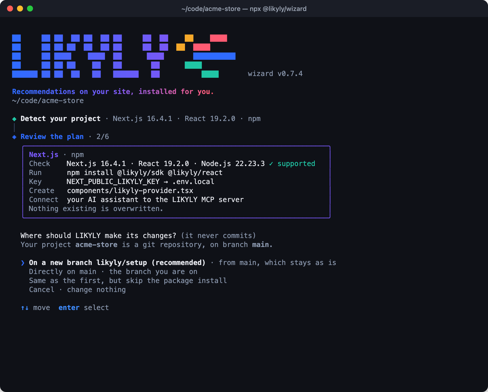
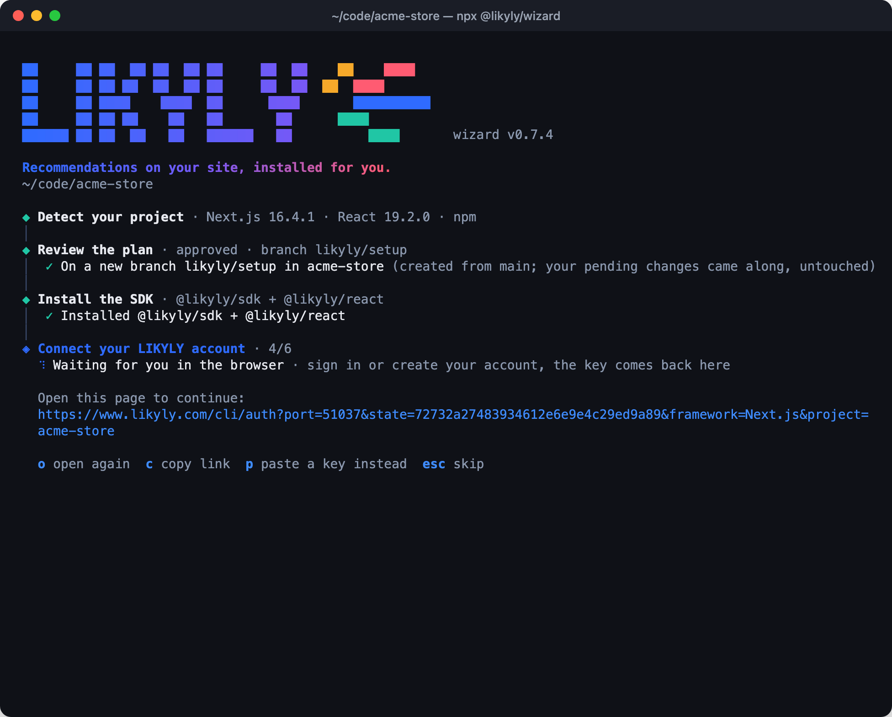
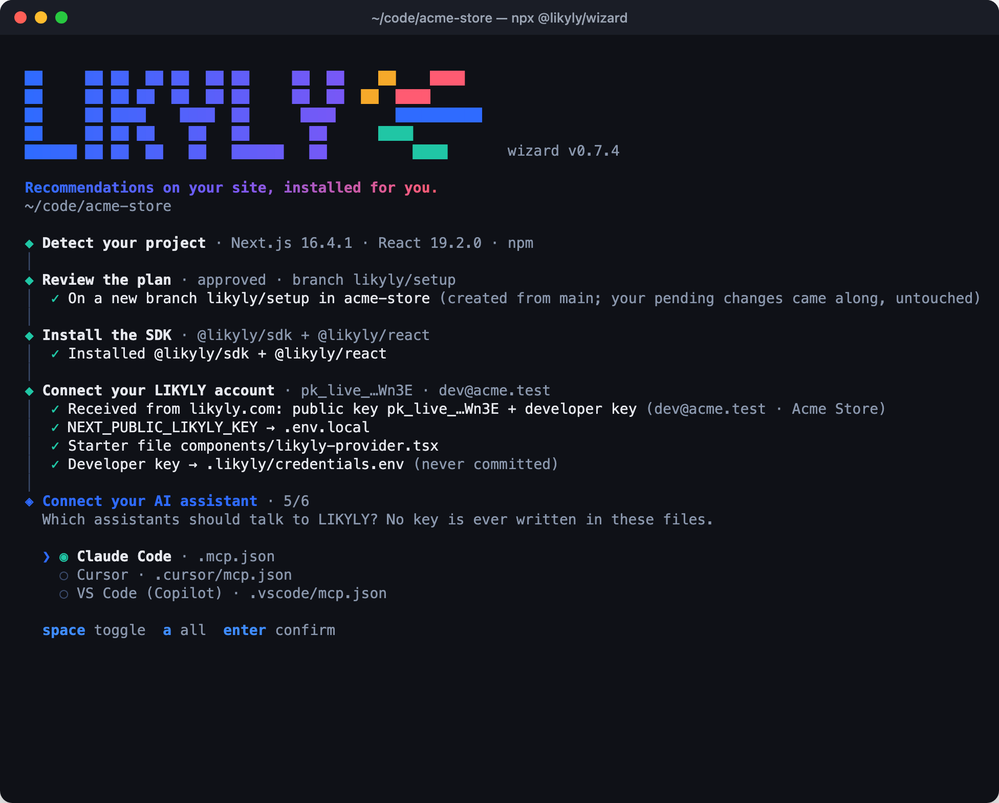
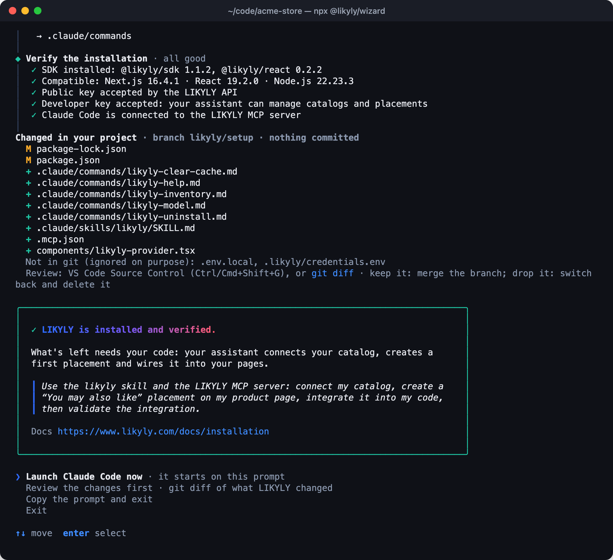

# @likyly/wizard

Install LIKYLY in a project with one command:

```bash
npx @likyly/wizard
```



An interactive terminal UI (built with [Ink](https://github.com/vadimdemedes/ink)) walks you through five steps:

1. **Detect your project**: the framework from the project's own files (`package.json`,
   `composer.json`, `pyproject.toml`, `Gemfile`, `go.mod`, `Cargo.toml`, `*.csproj`, `pom.xml`,
   `wp-config.php`, a Shopify theme's `layout/theme.liquid`, a Magento store's `composer.json`) and the package manager already in
   use (npm, pnpm, yarn, bun, composer, uv, poetry, bundler…). Nothing recognised: it says so and
   stops.
2. **Review the plan**: every command it will run and every file it will write, before anything
   happens. Nothing existing is overwritten. In a git repository it offers to work on a new
   branch, `likyly/setup` (your uncommitted work comes along, untouched), and it never commits.
3. **Install the SDK** (`@likyly/sdk`, plus `@likyly/react` for React frameworks; on Laravel the
   [`likyly/laravel`](https://packagist.org/packages/likyly/laravel) package, then it tells you to
   run `php artisan likyly:install`), with the package manager's output streamed live. Bare `pip`, Maven/Gradle and WordPress are shown, not run.
4. **Connect your LIKYLY account**: opens likyly.com, where you sign in or create an account
   (email, GitHub or Google); the public key comes back to the wizard on its own (a form POST to
   a one-time server on `127.0.0.1`, guarded by a random `state`). You can also paste a key or
   skip. The key is written under the name the framework exposes to the browser
   (`NEXT_PUBLIC_LIKYLY_KEY`, `VITE_LIKYLY_KEY`, `PUBLIC_LIKYLY_KEY`…), plus a starter file (React
   provider, Nuxt plugin, SvelteKit module…). Secret (`sk_`) and developer (`lk_`) keys are refused.
5. **Connect your AI assistant** to the [LIKYLY MCP server](https://www.npmjs.com/package/@likyly/mcp-server)
   and give it the LIKYLY skill. The assistants installed on your machine (or already used in
   the project) are ticked to begin with:

   | Assistant | MCP config | Skill |
   |---|---|---|
   | Claude Code | `.mcp.json` | `.claude/skills/likyly` (+ the `/likyly-*` commands) |
   | Cursor | `.cursor/mcp.json` | `.agents/skills/likyly` |
   | VS Code (Copilot) | `.vscode/mcp.json` | `.github/skills/likyly` |
   | Codex (OpenAI) | `.codex/config.toml` | `.agents/skills/likyly` |
   | Antigravity (Google, ex-Gemini CLI) | `.agents/mcp_config.json` | `.agents/skills/likyly` |
   | Mistral Vibe | `.vibe/config.toml` | `.agents/skills/likyly` |
   | Kiro (AWS) | `.kiro/settings/mcp.json` | `.kiro/skills/likyly` |
   | Junie (JetBrains) | `.junie/mcp/mcp.json` | `.junie/skills/likyly` |

   The developer key is never written to these files: they reference `LIKYLY_DEVELOPER_KEY`
   where the tool expands variables, otherwise the server reads `.likyly/credentials.env`.
   Codex and Mistral Vibe read project config only in a folder you trusted. Not supported:
   Windsurf / Devin Desktop (its MCP config is global, not per project).

6. **Verify the installation**: SDK installed and its version, your stack supported (Next.js
   13+, React 18–19, Node 18+, ...), public and developer keys accepted by the API, assistants
   connected.

Before that, it lists what it changed in your project - apart from what you had already
modified - and what git does not track on purpose (`.env.local`, `.likyly/`). Review it in VS
Code's Source Control panel or with `git diff`; "Review the changes first" opens the diff.

It ends on one choice, Enter by default: **Launch Claude Code** (or **Codex**) on the integration prompt (or open
Cursor with the prompt copied). Your assistant then connects the catalog, creates the placement,
wires it into your pages and validates the integration - ask it in plain words ("check my LIKYLY
integration", "empty the LIKYLY cache"), there are no commands to learn.

In Claude Code the same are `/likyly-clear-cache [placement]` and `/likyly-uninstall`, plus
`/likyly-help` (the list of commands), installed with the skill: Claude Code runs the command
itself and shows its result. Four read-only reports come with them:

- `/likyly-inventory` - what LIKYLY added to the site: each recommendation block, the page it is
  on and how it is set up in LIKYLY; the events the code sends; the setup files. It starts from
  `inventory` (below), then reads the code and asks LIKYLY.
- `/likyly-pages` - where to see LIKYLY: one link per kind of page that has a recommendation
  block (a product, a category, the home page, the cart...), on your computer and live - never
  one per product. `npx @likyly/wizard pages` gives what LIKYLY knows for sure (the blocks, a few
  real items and their URL, the store or domain, the local preview and whether it runs); Claude
  reads the code only for a route the data can't give (a Next.js product page's path), filled
  with a real item.
- `/likyly-impact [days]` - what the recommendations bring: blocks served, products seen,
  products clicked (CTR), and the purchases and revenue they led to, in total and per block, with
  what each number counts - a block served counts 1, each product of a block that comes into view
  counts 1 (a block of 4 seen = 4), so more products seen than blocks served is normal; a block
  served but never seen is flagged. Exact numbers from LIKYLY's analytics, read by
  `npx @likyly/wizard impact` with the developer key. Free: the last 7 days; Pro: up to 90 days,
  the day-by-day trend and the products recommendations worked best on.
- `/likyly-model [catalog] [days]` - the recommendation model: the version serving production
  (training date, precision@10, the data it learned from), the other versions and why they are
  not live, and what each engine served and earned on the site (MCP tool `get_model_overview`,
  API `GET /models/overview`, readable with the developer key).

`inventory` (also `--json`) lists the LIKYLY packages and versions, the key variable (never its
value), the setup files and every source line that mentions LIKYLY; it changes nothing. Uninstall shows the plan, then asks whether to proceed and on which
branch: a new `likyly/uninstall` branch (recommended) or the current one. When the wizard runs
from a local checkout instead of npm, the commands call that checkout.

`uninstall` removes the SDK packages, the public key line, the starter file (unless you edited
it), the `likyly` server from each assistant's MCP config, the skill, the commands and
`.likyly/`. It never edits your code: it lists the files that still use LIKYLY so your assistant
can take them out. Your LIKYLY account (catalog, placements, keys) is not touched.

The developer key comes back from the browser sign-in too and is stored in
`.likyly/credentials.env` (that folder ignores itself in git, file readable by you only); the
MCP server reads it there, so nothing needs exporting.

## Shopify themes

Run it in a theme pulled with Shopify CLI (`shopify theme pull --store <shop>.myshopify.com`).
Nothing is installed: the wizard writes the public key to `snippets/likyly-key.liquid` and adds
`sections/likyly-recommendations.liquid`, a self-contained section (the SDK comes from jsDelivr)
that sends the product view, shows the products LIKYLY recommends - read from the store itself,
so prices follow the visitor's currency - and tracks impressions and clicks. Add it from the
theme editor (*Add section → LIKYLY recommendations*) or let your assistant put it in
`templates/product.json`, then preview with `npx @likyly/wizard preview` (it runs
`shopify theme dev --store <your store>` right here, in your terminal, where you type the
storefront password; Ctrl+C gives you your terminal back; `--new-window` runs it in a separate
window. A preview of this theme already running: it just gives its address - another theme's
preview on 9292 is told apart, this one takes the next port) and publish with `shopify theme push`. Purchases happen on Shopify's checkout, where no theme
code runs: `npx @likyly/wizard pixel` prints (and copies) a pixel to paste once in the admin,
*Settings → Customer events → Add custom pixel*. It sends add to cart and purchases, with their
price and the recommendation the product was clicked in (the section keeps that click in the
browser), so impact and the console show the revenue. Test it from the store's own address (or
the preview link `shopify theme dev` prints), not 127.0.0.1: the click and the checkout must
happen on the same domain. Right after you sign in, the wizard connects the store's catalog itself:
you type the store address and the app's Client ID and secret (the secret is masked) in the
terminal, and they go straight to LIKYLY, encrypted - never to your AI assistant, never to a file.
The app is one from Shopify's Dev Dashboard installed on the store with `read_products` (or, on
an older store, a `shpat_` token). Later, or for another store: `npx @likyly/wizard shopify`.

In a Shopify **app** project (`shopify.app.toml`), the wizard installs and writes nothing but the
assistant's config: an app calls LIKYLY from its server with the secret key and shows
recommendations through a theme app extension (that is what
[LIKYLY for Shopify](https://github.com/Likyly/likyly-shopify) does).

## Magento / Adobe Commerce

Run it at the root of a Magento 2 store (Open Source, Mage-OS or Adobe Commerce: its
`composer.json` requires the product metapackage). Nothing goes through Composer: the wizard
writes a small module, `app/code/Likyly/Recommendations` - a block and its template (the SDK comes
from jsDelivr; it sends the product view, shows the recommended products with their image, price
and link, and tracks impressions and clicks), a widget (*Content → Widgets → LIKYLY
recommendations*) and settings (*Stores → Configuration → Catalog → LIKYLY*) - with the public key
in its `etc/config.xml`. Your assistant then places the block with one layout file per page and
flushes the cache.

Right after you sign in, the wizard connects the store's catalog, with nothing to do in the Magento
admin: it finds how bin/magento runs in this project (DDEV, Warden, the Docker Compose service
mounting the store, or `php`), enables the module (`module:enable`, `setup:upgrade`,
`cache:flush`) and runs the module's `bin/magento likyly:integration`, which creates a read-only
Integration "LIKYLY" (catalog, stores, stock) and hands its credentials to the wizard - they go
straight to LIKYLY, encrypted, never on screen. LIKYLY then reads the products through the
store's REST API (signed requests). A store in production mode is left alone (a module there
needs a full deploy). Other ways, from the same step: type the bin/magento command yourself, or
give an Integration's four values made in the admin. Later, or for another store:
`npx @likyly/wizard magento`. `npx @likyly/wizard uninstall` disables the module with
bin/magento before removing its files (a module that vanishes while enabled breaks Magento).

## What it looks like

**Connect your account**: the browser opens likyly.com; once you are signed in, the keys come back to the terminal on their own.



**Connect your AI assistant**: the public key, the starter file and the developer key are in place; pick the assistants to connect.



**Done**: everything checked, every changed file listed on its own branch, and one choice left: hand over to your assistant.



## Commands

```bash
npx @likyly/wizard                 # full interactive install
npx @likyly/wizard mcp add         # only connect your AI assistant
npx @likyly/wizard detect          # print what was detected, change nothing
npx @likyly/wizard cache clear     # empty LIKYLY's recommendation cache, every placement
npx @likyly/wizard cache clear pdp-related   # ... or one placement
npx @likyly/wizard uninstall       # remove what the wizard added (shows the plan, asks first; --dry-run to only look)
npx @likyly/wizard uninstall --yes --branch new   # ... without questions, on a new likyly/uninstall branch (or --branch current)
npx @likyly/wizard help            # the list of commands
npx @likyly/wizard --yes --public-key pk_... --editor claude-code,cursor   # CI, no prompts
npx @likyly/wizard --dry-run       # show what would happen
npx @likyly/wizard --hosted        # hosted MCP (mcp.likyly.com) instead of npx
```

The terminal needs at least 64×20: below that the wizard asks you to enlarge the window and
resumes on its own. `LIKYLY_APP_URL` points the sign-in at another site (e.g.
`http://localhost:6001`), `BROWSER=none` prints the link instead of opening it.

Testing against a local LIKYLY: `LIKYLY_API_URL` (e.g. `http://127.0.0.1:6061`) is used by the
verify step and written as the MCP server's `LIKYLY_BASE_URL`, and `LIKYLY_MCP_SERVER` (path to a
built `mcp/dist/index.js` from [Likyly/sdks](https://github.com/Likyly/sdks)) makes the MCP config run that file with `node` instead of the npm
package.

With `--yes`, in CI, or when the output is piped, the wizard prints plain lines instead of the
interactive UI and exits non-zero when a step fails.

## Development

```bash
npm install
npm run build                                    # bundles src/ into dist/cli.mjs (esbuild)
npm test                                         # builds, then node:test
node bin/likyly-wizard.mjs --dry-run --dir ../../examples/demo-storefront
```

- `src/actions.mjs`: the steps, shared by both renderers
- `src/ui/`: the Ink UI (`app.jsx` flow, `widgets.jsx` controls, `theme.jsx` brand palette and logo)
- `src/plain.mjs`: the CI renderer

Ink and React are bundled into `dist/cli.mjs`, so the published package has no dependencies and
`npx` starts instantly. Requires Node.js 22+. The skill is copied from `docs/SKILL.md` at
`npm pack` time (`prepack`); in the monorepo it is read directly.

Before publishing: `@likyly/sdk`, `@likyly/react` and `@likyly/mcp-server` must be on npm (the
wizard installs them from the registry), and `mcp.likyly.com` deployed for `--hosted`.
